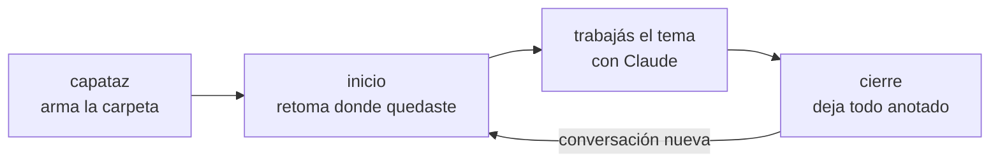

<p align="center">
  
</p>

<p align="center">
  
  
  
</p>

<p align="center">
  <b>Claude se olvida de una conversación a otra. La carpeta, no.</b><br>
  Un kit para que el equipo administrativo trabaje con Claude de forma ordenada y repetible, sin escribir código.
</p>

<p align="center">
  <a href="#empezar-en-3-pasos">Empezar</a> ·
  <a href="docs/GUIA.md">Guía de uso</a> ·
  <a href="docs/MACHETE.md">Machete para imprimir</a> ·
  <a href="CHANGELOG.md">Novedades</a>
</p>

---

## Qué es

El **kit eQ** es un paquete de habilidades (*skills*) para Claude que se instala una sola vez. Le enseña a Claude a trabajar con el **método de la carpeta**:

- **Cada tema de trabajo tiene su carpeta.** Por ejemplo: la conciliación bancaria, las facturas de proveedores o las liquidaciones.
- **La carpeta es el cuaderno.** Adentro queda escrito de qué se trata el tema, sus reglas y dónde quedaron la última vez.
- **Tres palabras alcanzan:** **capataz** arma la carpeta, **inicio** retoma y **cierre** deja todo anotado.

## Por qué sirve

| Sin el kit | Con el kit |
|---|---|
| Cada conversación arranca de cero y hay que volver a explicar todo | Decís **inicio** y Claude te cuenta dónde quedaron y qué sigue |
| Las reglas del trabajo viven en la cabeza de cada uno | Quedan anotadas en la carpeta, y Claude propone sumar las nuevas en cada **cierre** |
| Una tarea que se repite sale distinta cada mes | Se arma una **receta** con pasos y controles, y Claude la sigue igual cada vez |
| Las conversaciones largas se ponen lentas y se pierden cosas | Conversaciones cortas, de un tema: nada se pierde porque queda en la carpeta |
| Miedo a que toque o borre algo | Trabaja sobre **copias**, nunca borra y controla los números contra la fuente |

## Empezar en 3 pasos

1. **Instalá el kit en Cowork.** Abrí **Customize** > **Plugins** > **Add** > **Add marketplace**, escribí `guidocameraeq/kit-eq` e instalá **kit-eq**. Prendé **Sync automatically** para recibir las mejoras solas.
2. **Creá una carpeta vacía** para tu primer tema, por ejemplo `Documentos\Claude\Conciliacion-bancaria`, y abrí una conversación de Cowork con esa carpeta.
3. **Escribí: "Capataz, es mi primera vez".** Te hace unas pocas preguntas, arma la carpeta y te explica cómo seguir.

Los pasos con más detalle, el plan B si no te deja instalar y la instalación en Code están en la **[guía de uso](docs/GUIA.md#2-instalar-el-kit)**.

## Cómo se trabaja



| Palabra | Cuándo | Qué pasa |
|---|---|---|
| **capataz** | Tenés un tema nuevo | Te hace hasta 5 preguntas, de a una, y arma la carpeta con su `CLAUDE.md` |
| **inicio** | Abrís una conversación nueva en la carpeta de un tema | Claude lee la carpeta y te cuenta en 3 líneas dónde quedaron y qué sigue. Si la carpeta está vacía, la arma |
| **cierre** | Terminás por hoy | Claude te muestra qué va a anotar y, con tu OK, deja la carpeta al día |

**Un tema por conversación.** Si cambiás de tema o Claude se pone lento: **cierre** y conversación nueva. Con **inicio** se retoma sin perder nada.

## Qué trae

**Paquete `kit-eq`**: para todos, en Cowork y en Code.

| Skill | Para qué | Decí algo como... |
|---|---|---|
| `capataz` | Te da la bienvenida, arma o completa la carpeta de un tema y te cuenta qué podés hacer | *"Capataz, armame una carpeta para las facturas de proveedores"* |
| `inicio` | Retoma donde quedaste y, si hay receta, la corre paso a paso | *"inicio"* |
| `cierre` | Deja anotado qué se hizo, qué sigue y lo que aprendió del tema | *"cierre"* |

**Paquete `kit-eq-code`**: solo en la pestaña Code, para quien saca datos del sistema.

| Skill | Para qué | Decí algo como... |
|---|---|---|
| `configurar` | Deja la PC lista, una sola vez | *"configurar"* |
| `reportes` | Saca datos del sistema a un Excel, en solo lectura, con totales y controles | *"Sacame los saldos de septiembre en Excel"* |

Excel, Word, PowerPoint y PDF los arma Claude con sus habilidades oficiales.

**Próximamente:** revisar y ordenar una carpeta que ya usás, pasar un proceso a receta (`anotar`) y una "segunda opinión" sobre un resultado (`verificar`).

## Cómo queda una carpeta de tema

```
Conciliacion-bancaria/
├── CLAUDE.md             De qué se trata, quién lo hace, reglas y palabras del tema
├── LEEME-PRIMERO.md      El mapa de la carpeta
├── SESSION_HANDOFF.md    Dónde quedamos y qué sigue (lo escribe "cierre")
├── CHANGELOG.md          Una línea por día con lo hecho
├── RECETA.md             Los pasos del proceso (solo si el tema se repite)
├── originales/           Copias de los archivos con los que se trabaja
└── resultados/           Lo que arma Claude
```

El Capataz conoce esta **carpeta modelo**. Si la carpeta está vacía la arma, y si está a medio armar completa lo que falta, sin pisar nada.

## Seguridad

- **No borra ni toca tus originales.** Se trabaja sobre copias, y lo dudoso va a `_revisar/`.
- **No escribe sin mostrar antes.** Las carpetas, el `CLAUDE.md` y lo que anota el cierre se escriben con tu OK.
- **Controla los números** contra la fuente antes de entregarlos.
- **La base de datos solo se lee.** `reportes` hace consultas de lectura sobre vistas y nunca modifica nada.
- **Este repo no tiene datos de la empresa.** La conexión y el catálogo de vistas son privados y viven fuera del repo.

## Documentación

| Para... | Leé |
|---|---|
| Usar el kit, paso a paso | **[Guía de uso](docs/GUIA.md)** |
| Tener las frases a mano | **[Machete](docs/MACHETE.md)** (una página, para imprimir) |
| Ver qué cambió en cada versión | **[CHANGELOG](CHANGELOG.md)** |
| Entender el diseño | [Diseño](docs/DISENO.md) |
| Mantener el kit | [Cómo trabajamos](docs/COMO-TRABAJAMOS.md) · `py herramientas/revisar.py` antes de cada commit · `py herramientas/empaquetar.py` arma el zip del plan B |

## Estado

**Versión 0.2.0.**
- **Probado en Code:** se validó con la herramienta oficial de plugins y se ensayó con una alumna ficticia (bienvenida, carpeta nueva, carpeta a medio armar, guía y cierre).
- **NO VERIFICADO en Cowork Pro:** la instalación desde la tienda y el uso del kit. Se confirma en el primer uso.

El detalle está en el [CHANGELOG](CHANGELOG.md).

## Licencia

[MIT](LICENSE).
